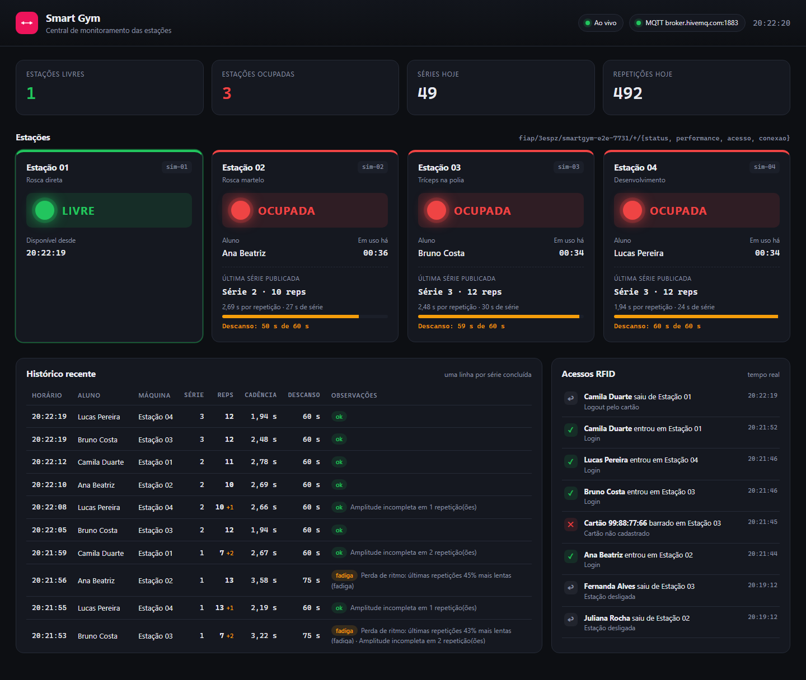
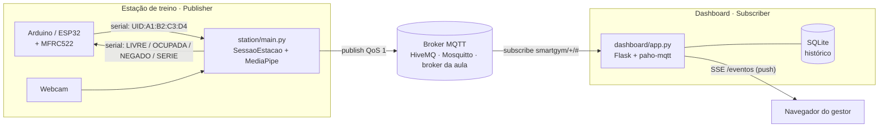
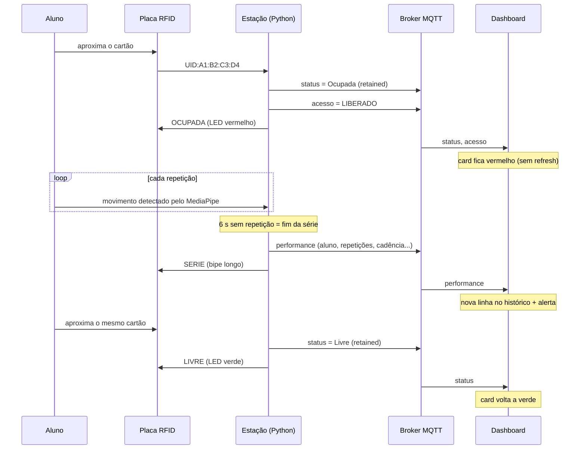
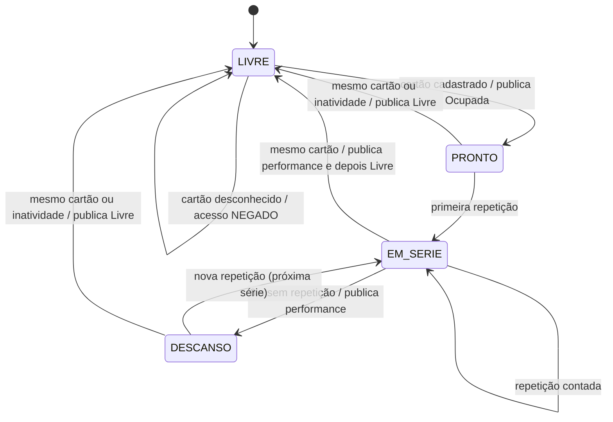

# Smart Gym · Telemetria IoT com MQTT

**Checkpoint 05 · Physical Computing (IoT & IoB)** · Engenharia de Software · FIAP · Turma 3ESPZ · Prof. Lucas D. Augusto

A estação de treino virou um dispositivo conectado. O aluno se identifica com o cartão RFID, a câmera (MediaPipe) conta as repetições e a estação publica tudo via **MQTT**. Um **dashboard web** assina esses tópicos e mostra para o gestor da academia, em tempo real e sem refresh, quais máquinas estão livres (verde) ou ocupadas (vermelho), quem treinou e quantas repetições fez em cada série.



---

## Equipe

| Nome | RM |
|------|----|
| _Nome do integrante 1_ | _RM00000_ |
| _Nome do integrante 2_ | _RM00000_ |
| _Nome do integrante 3_ | _RM00000_ |

---

## Sumário

1. [O que o sistema faz](#1-o-que-o-sistema-faz)
2. [Arquitetura](#2-arquitetura)
3. [Contrato MQTT (tópicos e payloads)](#3-contrato-mqtt-tópicos-e-payloads)
4. [Lógica de estados da estação](#4-lógica-de-estados-da-estação)
5. [Hardware e montagem](#5-hardware-e-montagem)
6. [Estrutura do repositório](#6-estrutura-do-repositório)
7. [Setup](#7-setup)
8. [Execução](#8-execução)
9. [Roteiro da demonstração](#9-roteiro-da-demonstração)
10. [Testes](#10-testes)
11. [Decisões técnicas](#11-decisões-técnicas)
12. [Solução de problemas](#12-solução-de-problemas)

---

## 1. O que o sistema faz

| Requisito do Checkpoint | Como foi atendido |
|---|---|
| Status de ocupação via MQTT, ativado pelo login/logout do RFID | Ao ler um cartão cadastrado, a estação publica `status = "Ocupada"` no mesmo instante; ao ler o mesmo cartão de novo, publica `"Livre"`. |
| Performance ao final de cada série | Quando o aluno para de se mexer por 6 s, a série é fechada e a estação publica nome do aluno, repetições, cadência, fadiga e descanso sugerido. Nada é enviado durante a série. |
| Dashboard com indicador verde/vermelho em tempo real | Flask assina o broker e empurra cada mudança para o navegador por Server-Sent Events. O card da máquina troca de cor sozinho. |
| Histórico recente atualizado automaticamente | Tabela com uma linha por série concluída (gravada em SQLite para não se perder ao reiniciar). |
| Arquitetura Publish/Subscribe | `station/` é o publisher, `dashboard/` é o subscriber; um não conhece o outro, só o broker e o contrato de tópicos. |

Além do mínimo pedido:

- **Validação de acesso visível no dashboard:** cartão não cadastrado ou de outro aluno com a máquina ocupada gera um evento `acesso = NEGADO`, que aparece no feed "Acessos RFID" e num alerta vermelho.
- **Estação offline:** se a estação cair (queda de energia, rede), o próprio broker publica o *Last Will* e o card fica cinza.
- **Qualidade do treino** (fatores do enunciado): repetições com amplitude incompleta são contadas à parte; perda de ritmo de 30% ou mais marca fadiga; o descanso sugerido varia entre 60 s e 90 s.
- **Escala:** o dashboard assina `+/status`, então qualquer nova estação aparece sozinha. O simulador sobe várias estações ao mesmo tempo para provar isso.

---

## 2. Arquitetura



Fluxo completo de um treino:



**Por que o Python valida o cartão, e não a placa?** O cadastro de alunos fica num único lugar (`station/alunos.json`), a placa fica simples e a mesma lógica serve para Arduino Uno (sem Wi-Fi) e ESP32.

---

## 3. Contrato MQTT (tópicos e payloads)

Hierarquia: `<TOPICO_RAIZ>/<estacao_id>/<tipo>`. Padrão: `fiap/3espz/smartgym/estacao-01/status`.

| Tópico | Publicado por | QoS | Retain | Quando |
|---|---|---|---|---|
| `.../status` | estação | 1 | **sim** | login e logout via RFID (`"Livre"` / `"Ocupada"`) |
| `.../performance` | estação | 1 | não | ao final de **cada série concluída** |
| `.../acesso` | estação | 1 | não | toda leitura de cartão: `LIBERADO`, `NEGADO`, `SAIDA` |
| `.../conexao` | estação e broker (LWT) | 1 | **sim** | ao conectar (`online: true`) e na queda (`online: false`) |

O dashboard assina `<TOPICO_RAIZ>/+/status`, `+/performance`, `+/acesso` e `+/conexao`. O curinga `+` captura qualquer estação.

<details>
<summary><b>Exemplos de payload (JSON)</b></summary>

`fiap/3espz/smartgym/estacao-01/status` (retained)

```json
{
  "estacao_id": "estacao-01",
  "estacao_nome": "Estação 01",
  "exercicio": "Rosca direta",
  "status": "Ocupada",
  "aluno": "João Silva",
  "plano": "Musculação Avançado",
  "desde": "2026-10-19T20:14:03-03:00",
  "ts": "2026-10-19T20:14:03-03:00"
}
```

`fiap/3espz/smartgym/estacao-01/performance`

```json
{
  "id": "4f1c0f7e2b6a4d0c9a7f3e1b2c3d4e5f",
  "estacao_id": "estacao-01",
  "estacao_nome": "Estação 01",
  "exercicio": "Rosca direta",
  "aluno": "João Silva",
  "plano": "Musculação Avançado",
  "serie": 2,
  "repeticoes": 12,
  "repeticoes_incompletas": 1,
  "duracao_s": 31.4,
  "cadencia_media_s": 2.42,
  "fadiga": true,
  "alertas": [
    "Perda de ritmo: últimas repetições 38% mais lentas (fadiga)",
    "Amplitude incompleta em 1 repetição(ões)"
  ],
  "descanso_sugerido_s": 75,
  "motivo_fim": "pausa",
  "ts": "2026-10-19T20:16:41-03:00"
}
```

`fiap/3espz/smartgym/estacao-01/acesso`

```json
{
  "estacao_id": "estacao-01",
  "estacao_nome": "Estação 01",
  "resultado": "NEGADO",
  "uid": "99:88:77:66",
  "aluno": null,
  "motivo": "Cartão não cadastrado",
  "ts": "2026-10-19T20:13:55-03:00"
}
```

`fiap/3espz/smartgym/estacao-01/conexao` (retained; também é o Last Will)

```json
{ "estacao_id": "estacao-01", "estacao_nome": "Estação 01", "online": false, "motivo": "queda inesperada (LWT)", "ts": "..." }
```

</details>

O contrato está no código em [`shared/topicos.py`](shared/topicos.py), usado pelos dois lados.

---

## 4. Lógica de estados da estação

A regra de negócio fica em [`station/sessao.py`](station/sessao.py), isolada de MQTT, câmera e serial. Ela recebe eventos (`cartao_lido`, `registrar_repeticao`, `tick`) e decide o que publicar. Por isso dá para testar sem hardware e reaproveitar no simulador.



| Situação | O que a estação faz |
|---|---|
| Cartão cadastrado com máquina livre | publica `status=Ocupada` **antes de qualquer outra coisa**, depois `acesso=LIBERADO`; LED vermelho |
| Cartão não cadastrado | `acesso=NEGADO` ("Cartão não cadastrado"); LED pisca + 2 bipes; status não muda |
| Outro aluno com a máquina ocupada | `acesso=NEGADO` ("Estação ocupada por …") |
| Mesmo cartão de novo | fecha a série em andamento (publica a performance), `acesso=SAIDA`, `status=Livre` |
| Cartão parado em cima do leitor | leituras repetidas em 2,5 s são ignoradas (*debounce* no firmware e no Python) |
| 180 s sem atividade | logout automático, para a máquina não ficar "ocupada" para sempre |
| Estação fechada (Q / Ctrl+C) | logout + `conexao=offline` |
| Estação cai sem avisar | o broker publica o Last Will: `conexao=offline` |

### Contagem de repetições

[`station/contador.py`](station/contador.py) usa o ângulo do cotovelo (ombro, cotovelo e pulso do MediaPipe Pose), escolhendo o braço mais visível:

```
AGUARDANDO_EXTENSAO --(ângulo > 150°)--> ESTENDIDO --(ângulo < 130°)--> EM_MOVIMENTO --(ângulo > 150°)--> ESTENDIDO  ⇒ +1 repetição
```

A faixa de 130° a 150° funciona como histerese: tremidas perto da extensão não viram repetição. Ao fechar o ciclo, a repetição é **completa** se o menor ângulo chegou a 55° ou menos; senão é **incompleta** (amplitude parcial).

### Qualidade do treino (fatores do enunciado)

| Fator | Implementação |
|---|---|
| Amplitude de movimento | repetições incompletas são contadas à parte (`repeticoes_incompletas`) e geram alerta |
| Cadência e fadiga | `cadencia_media_s` é o tempo médio por repetição. Se o último terço da série ficou **30% ou mais** mais lento que o primeiro, `fadiga=true`. Menos de 1 s por repetição gera o alerta "execução rápida demais" |
| Descanso de 60 s a 90 s | 60 s como base; +15 s se houver fadiga; +15 s se 30% ou mais das repetições foram incompletas ou rápidas demais |
| Identificação | perfil (nome e plano) carregado pelo UID do RFID em `station/alunos.json` |

---

## 5. Hardware e montagem

| Componente | Qtd |
|---|---|
| Arduino Uno/Nano **ou** ESP32 DevKit | 1 |
| Módulo RFID MFRC522 + cartões/tags MIFARE 13,56 MHz | 1 |
| LED verde + LED vermelho + 2 resistores de 220 Ω | 1 cada |
| Buzzer ativo 5 V | 1 |
| Webcam (a do notebook serve) | 1 |

> ⚠️ O MFRC522 é **3,3 V**. No Uno, ligue o VCC do módulo no pino 3V3, nunca no 5V.

| MFRC522 / periférico | Arduino Uno/Nano | ESP32 DevKit |
|---|---|---|
| SDA (SS) | D10 | GPIO 5 |
| SCK | D13 | GPIO 18 |
| MOSI | D11 | GPIO 23 |
| MISO | D12 | GPIO 19 |
| RST | D9 | GPIO 22 |
| 3.3V / GND | 3V3 / GND | 3V3 / GND |
| LED verde (+ 220 Ω) | D6 | GPIO 25 |
| LED vermelho (+ 220 Ω) | D7 | GPIO 26 |
| Buzzer | D8 | GPIO 27 |

O sketch [`firmware/smartgym_rfid/smartgym_rfid.ino`](firmware/smartgym_rfid/smartgym_rfid.ino) escolhe os pinos sozinho pelo `#if defined(ESP32)`.

**Protocolo serial (115200 baud, uma mensagem por linha):**

| Direção | Mensagem | Efeito |
|---|---|---|
| placa → Python | `UID:A1:B2:C3:D4` | cartão lido |
| Python → placa | `LIVRE` | LED verde aceso |
| Python → placa | `OCUPADA` | LED vermelho aceso |
| Python → placa | `NEGADO` | pisca vermelho + 2 bipes |
| Python → placa | `SERIE` | bipe longo (série publicada) |

O Python também aceita o formato do firmware do Checkpoint 01 (`ACESSO_LIBERADO:<uid>`).

---

## 6. Estrutura do repositório

```
smart-gym-iot-mqtt/
├── firmware/
│   └── smartgym_rfid/smartgym_rfid.ino   # Arduino/ESP32 + MFRC522 (leitura do cartão, LEDs, buzzer)
├── station/                              # PUBLISHER: a estação de treino
│   ├── main.py                           # ponto de entrada: loop câmera + RFID + MQTT
│   ├── sessao.py                         # máquina de estados e regras de publicação
│   ├── contador.py                       # contagem de repetições por ângulo do cotovelo
│   ├── visao.py                          # MediaPipe Pose -> ângulo
│   ├── rfid.py                           # leitura serial e parser do UID
│   ├── publicador.py                     # cliente MQTT (QoS 1, retain, Last Will)
│   ├── hud.py                            # interface na janela da câmera (OpenCV)
│   ├── config.py                         # parâmetros (ângulos, tempos, porta serial)
│   └── alunos.json                       # cadastro UID -> aluno
├── dashboard/                            # SUBSCRIBER: painel web do gestor
│   ├── app.py                            # Flask: página, /api/estado e stream SSE /eventos
│   ├── assinante.py                      # cliente MQTT que assina os tópicos
│   ├── painel.py                         # estado em memória + difusão para os navegadores
│   ├── armazenamento.py                  # histórico em SQLite
│   ├── templates/index.html
│   └── static/ (style.css, app.js)
├── shared/                               # contrato comum aos dois lados
│   ├── topicos.py                        # tópicos, QoS, valores "Livre"/"Ocupada"
│   ├── config.py                         # broker e prefixo (lê o .env)
│   └── mqtt_cliente.py                   # fábrica do cliente paho (credenciais, TLS, reconexão)
├── tools/
│   ├── simulador.py                      # N estações virtuais (sem câmera/placa)
│   ├── monitor_mqtt.py                   # imprime todo o tráfego do tópico raiz
│   └── limpar_retidos.py                 # apaga mensagens retidas de estações antigas
├── tests/                                # pytest: sessão, contador, protocolos, painel
├── docs/                                 # imagens do README
├── .env.example
├── requirements.txt
└── pyproject.toml
```

---

## 7. Setup

**Pré-requisitos:** Python **3.9 a 3.12** (o MediaPipe 0.10.21 ainda não roda no 3.13), Arduino IDE 2.x e Git.

```bash
git clone https://github.com/<usuario>/smart-gym-iot-mqtt.git
cd smart-gym-iot-mqtt

python -m venv .venv
# Windows
.venv\Scripts\activate
# Linux/macOS
source .venv/bin/activate

pip install -r requirements.txt
```

**Configuração (opcional, mas recomendado):**

```bash
cp .env.example .env      # Windows: copy .env.example .env
```

- `TOPICO_RAIZ`: em broker público, troque por algo único do grupo (ex.: `fiap/3espz/smartgym/grupo7`). Senão vocês recebem mensagens de outras equipes.
- `MQTT_HOST` / `MQTT_PORT`: broker da aula, `broker.hivemq.com` (padrão) ou `localhost` com Mosquitto.

**Firmware:**

1. Arduino IDE > *Gerenciar Bibliotecas* > instale **MFRC522** (GithubCommunity / miguelbalboa).
2. Para ESP32: *Gerenciador de Placas* > instale **esp32** (Espressif) e selecione *ESP32 Dev Module*.
3. Abra `firmware/smartgym_rfid/smartgym_rfid.ino`, selecione a placa e a porta, e faça o upload.
4. Abra o Monitor Serial (115200), aproxime cada cartão e anote o UID (`UID:XX:XX:XX:XX`).
5. Cadastre os UIDs em `station/alunos.json`:

```json
{
  "A1:B2:C3:D4": { "nome": "João Silva", "plano": "Musculação Avançado" }
}
```

> Feche o Monitor Serial antes de rodar a estação: só um programa pode usar a porta por vez.

---

## 8. Execução

Todos os comandos rodam a partir da raiz do repositório, com o venv ativo.

**Terminal 1: dashboard (subscriber)**

```bash
python -m dashboard.app
```

Abra **http://localhost:5000**. O selo "MQTT" no topo fica verde quando o broker conecta.

**Terminal 2: estação (publisher)**

```bash
python -m station.main                 # câmera + RFID (porta detectada automaticamente)
python -m station.main --porta COM5    # porta serial explícita (Linux: /dev/ttyUSB0)
python -m station.main --sem-serial    # sem placa: cartões pelo teclado
python -m station.main --sem-camera    # sem webcam: repetições pela barra de espaço
```

Para uma segunda estação na mesma máquina:

```bash
python -m station.main --estacao-id estacao-02 --estacao-nome "Estação 02" --sem-camera --sem-serial
```

Teclas na janela da estação (servem de plano B na apresentação):

| Tecla | Ação |
|---|---|
| `1` `2` `3` | simula o cartão do 1º, 2º e 3º aluno de `alunos.json` |
| `0` | simula um cartão **não cadastrado** |
| `Espaço` / `I` | repetição completa / incompleta |
| `F` | encerra a série agora (publica a performance) |
| `L` | logout |
| `Q` / `Esc` | sai (faz logout e publica offline) |

**Opcional: ver o tráfego MQTT cru (bom para explicar o pub/sub)**

```bash
python -m tools.monitor_mqtt
```

**Opcional: simular várias estações sem hardware**

```bash
python -m tools.simulador --estacoes 4            # tempo acelerado 4x, Ctrl+C para parar
python -m tools.limpar_retidos sim-01 sim-02 sim-03 sim-04   # depois, tira as estações simuladas do broker
```

---

## 9. Roteiro da demonstração

1. Subir o dashboard e projetar a página. Não há estação ainda.
2. Subir a estação. O card aparece **verde · Livre**; no terminal aparece `[MQTT] Status: Livre`.
3. Aproximar um **cartão não cadastrado**. A placa pisca vermelho e o feed "Acessos RFID" mostra *barrado · Cartão não cadastrado*.
4. Aproximar o **cartão do aluno**. Em menos de 1 s o card fica **vermelho · Ocupada** com o nome do aluno e o tempo de uso correndo.
5. Fazer uma série de rosca direta na frente da câmera. O HUD conta as repetições; nada é publicado ainda.
6. Parar por 6 s. A série é publicada: bipe longo na placa, nova linha no **Histórico recente**, alerta no canto e barra de descanso no card.
7. (Opcional) Aproximar outro cartão cadastrado: acesso **negado**, "Estação ocupada por …".
8. Aproximar o **mesmo cartão**: logout, card volta a **verde · Livre**.
9. (Opcional) Matar o processo da estação ou desligar o Wi-Fi: o broker entrega o *Last Will* e o card fica **cinza · Offline**.

---

## 10. Testes

```bash
python -m pytest
```

27 testes, sem broker, câmera nem placa:

- `test_sessao.py`: login publica "Ocupada" retained antes de tudo; cartão desconhecido e cartão de outro aluno são negados; debounce; logout publica "Livre"; performance **só** no fim da série; fadiga e amplitude mudam o descanso; logout no meio da série publica a performance antes do "Livre"; logout por inatividade.
- `test_contador.py`: ciclo completo, amplitude parcial, início com braço flexionado e ruído perto da extensão.
- `test_protocolos.py`: montagem e interpretação de tópicos; formatos de UID aceitos pela serial.
- `test_painel.py`: estado do dashboard, deduplicação de mensagens QoS 1, Last Will e difusão para navegadores.

O fluxo ponta a ponta foi validado com o simulador publicando no `broker.hivemq.com` e o dashboard recebendo (a imagem do topo é dessa execução).

---

## 11. Decisões técnicas

| Decisão | Motivo |
|---|---|
| **Publicação por evento**, sem envio periódico | segue a dica do enunciado: "Ocupada" sai no bipe do RFID e a performance só ao fim da série. Menos tráfego e nenhum dado desatualizado |
| **QoS 1** | garante que login, logout e séries cheguem ao broker mesmo com Wi-Fi instável; o paho reenvia ao reconectar |
| **`status` retained** | um dashboard aberto depois recebe na hora o estado atual de cada máquina, sem esperar o próximo login |
| **Last Will (`conexao`)** | diferencia "máquina livre" de "estação desligada/caída" |
| **`id` em cada performance + `INSERT OR IGNORE`** | o QoS 1 pode entregar a mesma mensagem duas vezes; o histórico não duplica |
| **Assinatura com curinga `+`** | nova estação = novo `ESTACAO_ID`, sem mudar nada no dashboard |
| **Flask + SSE** em vez de recarregar a página | o servidor empurra cada mensagem para o navegador; nada de refresh manual nem de polling. Sem dependência externa no front, funciona até sem internet com Mosquitto local |
| **Sessão desacoplada de MQTT/câmera/serial** | a mesma classe roda na estação real, no simulador e nos testes |
| **Payload validado e HTML escapado no dashboard** | em broker público qualquer um pode publicar no tópico; mensagens fora do contrato são descartadas |

---

## 12. Solução de problemas

| Sintoma | Solução |
|---|---|
| `RFID TECLADO` no HUD / "Nenhuma placa encontrada" | passe a porta: `--porta COM5`. Feche o Monitor Serial da Arduino IDE |
| Selo MQTT vermelho / estação não conecta | a rede pode bloquear a porta 1883. Use TLS na 8883: `MQTT_PORT=8883` e `MQTT_TLS=1` no `.env`, ou um Mosquitto local (`MQTT_HOST=localhost`) |
| Aparecem estações de outro grupo | troque `TOPICO_RAIZ` por um prefixo único |
| Estações simuladas continuam no dashboard | `python -m tools.limpar_retidos sim-01 sim-02 ...` |
| Zerar o histórico | apague `dashboard/dados/smartgym.db` com o dashboard parado |
| `module 'mediapipe' has no attribute 'solutions'` | use o `mediapipe==0.10.21` do `requirements.txt` com Python 3.9 a 3.12 |
| Repetições não contam | fique de lado para a câmera com o braço inteiro visível; ajuste `ANGULO_*` no `.env` |
